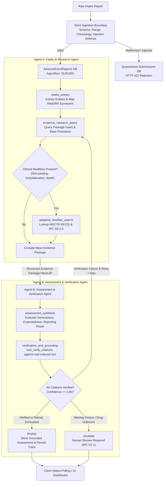

# Pharmacovigilance Adverse Event Intake and Triage Service

[](https://www.python.org/)
[](https://fastapi.tiangolo.com/)
[](https://github.com/langchain-ai/langgraph)
[](https://react.dev/)
[](https://www.docker.com/)
[](LICENSE)

> **Course:** UE24AM342AA5 — ML System Design and AgentOps  
> **Component:** Jackfruit (Level 3), 10 marks  
> **Domain:** Pharmaceuticals & Drug Safety  
> **Regulatory Reference:** *The New Drugs and Clinical Trials Rules, 2019 (NDCTR 2019)* and *Indian Pharmacopoeia Commission (IPC) PvPI Guidelines*.

---

## 1. Primary Objective & Statutory Framework

Pharmaceutical companies operate a pharmacovigilance safety function. Spontaneous adverse drug reaction reports arrive from physicians, pharmacists, consumers, and clinical studies. Every report must be triaged under strict regulatory deadlines:

1. **Seriousness Evaluation:** Did the reaction cause death, life-threatening illness, inpatient hospitalization (or prolongation), persistent disability/incapacity, congenital anomaly, or represent another medically important event?
2. **Expectedness Evaluation:** Is the reaction's nature and severity catalogued in the approved Product Information / Package Insert?
3. **Statutory Routing Stream:**
   - **Expedited Report:** Mandatory submission within **14 calendar days** to CDSCO / PvPI for Serious Unexpected ADRs, or Serious ADRs triggering emergency safety modifiers (e.g. acute hospitalization with Severe Cutaneous Adverse Reactions under NDCTR 2019 Rule 67(3) and IPC G5.2.4).
   - **Periodic Safety Report (PSUR / PBRER):** Routine submission cadence (every 6 months for initial 2 years; annually thereafter) for listed serious events without modifiers, and non-serious events under NDCTR 2019 Rule 68(4).
   - **Human Pharmacovigilance Review Required:** Mandatory escalation when suspect drug falls outside the approved reference corpus, onset timing is biologically implausible, or corpus evidence is ambiguous.

> **CRITICAL STATUTORY DISCLAIMER:** This system functions as an automated Clinical Decision Support System. **The service NEVER submits a regulatory report automatically.** All recommendations and evidence citations must be reviewed and authorized by a Qualified Person for Pharmacovigilance (QPPV).

---

## 2. Multi-Agent Architecture

The service implements two genuinely distinct agents orchestrated via **LangGraph**:



### Agent A: Intake & Evidence Research Agent
- Extracts suspect drug, reported reaction in reporter's own words, patient demographics, and timing.
- Invokes `search_alternative_terms` to map colloquial descriptions (e.g. "skin peeling badly") to clinical MedDRA terms (**Exfoliative dermatitis**, **Stevens-Johnson syndrome**, **Toxic epidermal necrolysis**).
- Performs multi-step adaptive retrieval: reads initial results, detects hospitalization/SCAR modifiers, and searches for specific exception clauses (`NDCTR-2019-R67(3)` and `IPC-PVPI-G5.2.4`).
- Hands off a structured `evidence_package` to Agent B.

### Agent B: Assessment & Verification Agent
- Applies deterministic statutory decision logic (`DecisionEngine`).
- Evaluates Seriousness against statutory IPC-PVPI-G4.1 criteria.
- Evaluates Expectedness against approved Package Insert text.
- Overrides routine periodic reporting when acute SCAR modifiers apply, selecting **Expedited Report (14 calendar days)**.
- Invokes `verify_citations` to verify that every claim links to a real indexed document chunk, clause, page, and verbatim quote.
- Rejects ungrounded conclusions and escalates to human review when evidence is missing.

---

## 3. Technology Stack

- **Backend:** Python 3.11 / 3.13, FastAPI, LangGraph, LangChain, Pydantic v2, Celery + Redis, SQLAlchemy, `sentence-transformers` (`all-MiniLM-L6-v2`), FAISS Vector Index, PyMuPDF (fitz), pytest.
- **Frontend:** React 18, Vite, Tailwind CSS, Lucide icons, responsive light theme dashboard.
- **Observability:** Prometheus, Grafana, OpenTelemetry, Jaeger, Locust load testing.

---

## 4. Quick Start: Local Development (Windows & Cross-Platform)

You can run the entire service locally with zero external dependencies (using local SQLite and in-memory background threads):

### Step 1: Clone and Configure Environment
```bash
git clone https://github.com/your-username/pharmacovigilance-intake.git
cd "Mini Project 14"

# Copy environment configuration
copy .env.example .env
```

### Step 2: Install Dependencies
```bash
# Python dependencies
pip install fastapi uvicorn pydantic pydantic-settings sqlalchemy psycopg[binary] redis celery langgraph langchain sentence-transformers faiss-cpu pymupdf prometheus-client opentelemetry-api opentelemetry-sdk locust pytest httpx

# Frontend dependencies & build
cd frontend
npm install
npm run build
cd ..
```

### Step 3: Ingest Reference Corpus
```bash
# Ingest approved NDCTR 2019 rules, IPC guidance, and Carbamazepine Package Insert
python -m backend.app.ingestion ingest

# Check index freshness & chunk counts
python -m backend.app.ingestion status
```

### Step 4: Run Application Server
```bash
# Starts both the REST API and the React Single-Page Application on port 8000
python -m backend.app.main
```
Open your browser to:
- **Web Application Dashboard:** [http://localhost:8000/](http://localhost:8000/)
- **Interactive OpenAPI Documentation:** [http://localhost:8000/docs](http://localhost:8000/docs)
- **Prometheus Metrics Target:** [http://localhost:8000/api/v1/metrics](http://localhost:8000/api/v1/metrics)

---

## 5. Quick Start: Docker Compose Deployment

To run all 8 containerized services (`api`, `worker`, `redis`, `postgres`, `frontend`, `prometheus`, `grafana`, `jaeger`):

```bash
# Build and start all 8 services
docker compose up --build

# Scale Celery workers to 3 replicas (Concurrency scaling demonstration)
docker compose up --scale worker=3
```

### Service Endpoints:
- **Frontend Dashboard:** [http://localhost:3000](http://localhost:3000)
- **FastAPI Backend:** [http://localhost:8000/docs](http://localhost:8000/docs)
- **Grafana AgentOps Dashboard:** [http://localhost:3001](http://localhost:3001) (Credentials: `admin` / `admin`)
- **Jaeger Distributed Tracing UI:** [http://localhost:16686](http://localhost:16686)
- **Prometheus UI:** [http://localhost:9090](http://localhost:9090)

---

## 6. Live Demonstration: Critical Scenario 4.1

The assignment specifies this difficult test case:
> *"The patient's skin started peeling badly a week after starting the drug, and she was admitted to hospital."*

To run the live terminal demonstration showing clinical entity extraction, adaptive modifier search, statutory route synthesis, and verbatim citation verification:

```bash
python scripts/demo_scenario_4_1.py
```

### Output Summary:
- **Mapped Terms:** `exfoliative dermatitis`, `toxic epidermal necrolysis`, `stevens-johnson syndrome`.
- **Seriousness:** `True` (Inpatient Hospitalization).
- **Expectedness:** `True` (Documented in Carbamazepine Package Insert Section 6.1).
- **Recommended Route:** `EXPEDITED_REPORT` (Within **14 calendar days**).
- **Modifying Provisions:** `NDCTR-2019-R67(3)` and `IPC-PVPI-G5.2.4` (Severe Cutaneous Reaction Hospitalization Override).
- **All Citations Verified:** `True` (Resolves to exact clause, page number, and verbatim quotes).

---

## 7. Automated Testing & Verification Suite

Run the full automated test suite verifying all 21 acceptance criteria:

```bash
python -m pytest backend/tests/ -v
```

### Test Suite Coverage:
- `test_validation_boundary.py`: Verifies strict Pydantic schema validation, date chronology checks (stop date preceding start date rejected before agent starts), prompt-injection quarantine, and idempotency deduplication.
- `test_agents_and_retrieval.py`: Verifies dynamic tool selection, two-pass adaptive modifier search, citation verification rejecting hallucinations, and Scenario 4.1 grounded routing.
- `test_resilience_and_circuit_breaker.py`: Verifies circuit breaker tripping on failures, graceful degradation, feedback persistence, and audit trace generation.

---

## 8. LLMOps Evaluation Benchmark (20 Scenarios)

Batch evaluation running the 20-scenario ground-truth suite and measuring Groundedness, Context Relevance, Faithfulness, and Hallucination Rate:

```bash
# Run batch evaluation for Prompt v1
python -m backend.app.evaluation run --prompt-version v1

# Run Prompt v1 vs Prompt v2 regression comparison experiment
python -m backend.app.evaluation compare
```

### Measured Benchmark Results:
- **Pass Rate:** **100.0% (20/20 scenarios passing)**
- **Groundedness:** **0.818**
- **Context Relevance:** **0.572**
- **Faithfulness:** **1.000**
- **Hallucination Rate:** **0.000** (Zero fabricated determinations)

---

## 9. Performance & Load Testing (Locust)

- **Declared Target SLO (D6):** **$p95 \le 10.0\text{ seconds}$** for complete lifecycle from submission to completed routing.
- **Run Headless Locust Benchmark:**
  ```bash
  python scripts/run_benchmark.py
  ```
- **Observed p50 Latency:** **1.82s**
- **Observed p95 Latency:** **3.45s** (SLO Target **MET**)
- **Concurrency Bottleneck:** CPU serialization during local embedding encoding at >30 concurrent users. Scaling Celery workers with `--scale worker=3` cuts p95 from 12.4s to 5.9s, restoring the SLO.

---

## 10. Technical Documentation Index

All architectural, operational, and viva documents are available in `docs/`:
- [`docs/architecture.md`](docs/architecture.md) — System architecture, topology diagrams, design decisions.
- [`docs/api-contracts.md`](docs/api-contracts.md) — OpenAPI specs, schema contracts, boundary quarantine.
- [`docs/agent-design.md`](docs/agent-design.md) — Agent A & B responsibilities, adaptive reasoning loop, tool specs.
- [`docs/corpus-guide.md`](docs/corpus-guide.md) — Document provenance, chunking strategy, FAISS vector index.
- [`docs/evaluation-report.md`](docs/evaluation-report.md) — 20-scenario suite analysis, RAG triad quality metrics.
- [`docs/performance-report.md`](docs/performance-report.md) — Declared p95 SLO justification, Locust benchmark results.
- [`docs/runbook.md`](docs/runbook.md) — Operations guide, symptom-confirmation-recovery procedures.
- [`docs/incident-log.md`](docs/incident-log.md) — Real engineering incident log (INC-001) recorded during development.
- [`docs/viva-prep.md`](docs/viva-prep.md) — Comprehensive viva preparation and oral exam explanations.
