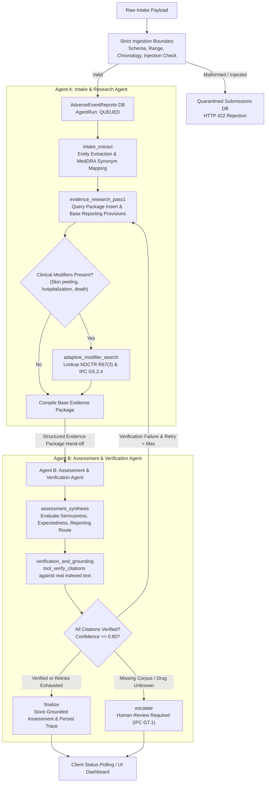

# Pharmacovigilance Adverse Event Intake and Triage Service: System Architecture

## 1. Executive Summary and Problem Domain

In pharmaceutical safety operations, Marketing Authorisation Holders (MAHs) and sponsors receive thousands of spontaneous, clinical trial, and literature adverse drug event reports. Under Indian regulatory mandates — specifically **The New Drugs and Clinical Trials Rules, 2019 (NDCTR 2019)** and **Indian Pharmacopoeia Commission (IPC) Pharmacovigilance Programme of India (PvPI)** guidance — every adverse event report must be triaged according to statutory criteria:

1. **Seriousness:** Did the adverse event cause death, life-threatening risk, inpatient hospitalization (or prolongation), persistent disability/incapacity, congenital anomaly, or represent another medically important event?
2. **Expectedness:** Is the reaction's nature, severity, and specificity consistent with the approved Summary of Product Characteristics / Package Insert?
3. **Statutory Routing:**
   - **Expedited Report:** Mandatory submission to the licensing authority within **14 calendar days** for Serious Unexpected ADRs, or Serious ADRs triggering emergency safety modifiers (e.g., acute hospitalization with Severe Cutaneous Adverse Reactions under NDCTR 2019 Rule 67(3) and IPC G5.2.4).
   - **Periodic Safety Report (PSUR / PBRER):** Routine submission cadence (every 6 months for initial 2 years; annually for subsequent 2 years) for listed serious events without emergency modifiers, and non-serious events under NDCTR 2019 Rule 68(4).
   - **Human Pharmacovigilance Review Required:** Mandatory escalation when suspect drug is outside the approved reference corpus, onset timing is ambiguous, or corpus evidence is conflicting.

> **CRITICAL STATUTORY DISCLAIMER:** This system functions strictly as a Clinical Decision Support System (CDSS). The system **NEVER submits a regulatory report automatically**. All determinations and evidence citations must be reviewed and authorized by a Qualified Person for Pharmacovigilance (QPPV).

---

## 2. Multi-Agent Topology and Hand-off Architecture

The system implements two distinct agents orchestrated via **LangGraph**:

### Agent A: Intake and Evidence Research Agent
- **State Responsibility:** Receives raw report fields, maps layperson terminology (e.g. "skin peeling badly") to clinical terms (MedDRA equivalents: Exfoliative dermatitis, TEN, SJS), and retrieves reference text.
- **Tools Invoked:**
  - `search_alternative_terms(terms)`
  - `search_corpus(query, filters, top_k)`
  - `lookup_clause(clause_id)`
  - `get_report_fields(run_id)`
- **Adaptive Reasoning:** Identifies modifying clauses that the reporter never mentioned (e.g. NDCTR Rule 67(3) acute hospitalization override) and constructs targeted secondary search queries.
- **Hand-off Contract:** Generates a structured `evidence_package` containing passage IDs, document titles, page numbers, and verbatim quotes.

### Agent B: Assessment and Verification Agent
- **State Responsibility:** Consumes the evidence package, evaluates statutory seriousness criteria against IPC-PVPI-G4.1, evaluates expectedness against approved Package Insert text, and determines reporting route.
- **Tools Invoked:**
  - `verify_citations(claims, retrieved_chunks)`: Checks that every claim and citation resolves strictly to indexed document chunks and verified quotes.
- **Escalation & Recovery:** If evidence is insufficient or citations fail verification, it either triggers a second targeted search pass or routes to `human_review_required`.

---

## 3. Technology Stack & Deployment Boundaries

| Service Component | Technology | Role |
| :--- | :--- | :--- |
| **API Server** | FastAPI (Python 3.11/3.13) | REST API, ingestion validation, OpenAPI docs, Prometheus metrics |
| **Orchestration** | LangGraph & LangChain | Multi-agent state graph, tool routing, bounded retry loop |
| **Vector Store** | FAISS + `sentence-transformers` | `all-MiniLM-L6-v2` local embeddings, cosine similarity search |
| **Ingestion Engine** | PyMuPDF (fitz) | PDF extraction, page tracking, clause segmentation, OCR fallback |
| **Task Queue** | Celery + Redis | Asynchronous job execution with in-memory thread pool fallback |
| **Database** | PostgreSQL / SQLite | Persistent reports, runs, steps, citations, feedback, quarantine |
| **Frontend** | React 18 + Vite | Professional dashboard, citation viewer, trace visualizer, LLMOps |
| **Observability** | Prometheus, Grafana, Jaeger | p50/p95 latency histograms, OpenTelemetry traces, Grafana panels |
| **Load Testing** | Locust | Headless lifecycle benchmark, p95 SLO verification |

---

## 4. Design Decisions & Rejected Alternatives

1. **Deterministic Rule Engine vs Raw LLM Generation:**
   - *Decision:* Implemented a dedicated `DecisionEngine` module grounded strictly in NDCTR 2019 and IPC PvPI clauses. The LLM handles entity extraction and semantic search synthesis, but **cannot override statutory rules or invent deadlines**.
   - *Rejected:* Allowing an end-to-end prompt to directly choose the reporting timeline. LLMs frequently hallucinate regulatory deadlines (e.g. inventing a 7-day rule for non-serious events).

2. **Adaptive Two-Pass Retrieval vs Single Embedding Search:**
   - *Decision:* Implemented an adaptive loop where Agent A inspects initial search findings, detects acute modifiers, and derives secondary queries (e.g., querying specifically for `NDCTR-2019-R67(3)`).
   - *Rejected:* Single vector search. As demonstrated in Scenario 4.1, a single query for "skin peeling badly" returns package insert rash entries but completely misses the separate statutory emergency hospitalization modifier in NDCTR 2019 Rule 67(3).

3. **Strict Ingestion Boundary vs Pipeline Error Handling:**
   - *Decision:* Malformed JSON, chronology errors (stop date preceding start date), and prompt-injection attempts are **quarantined immediately at the API boundary**, returning HTTP 422. No agent run is ever created.
   - *Rejected:* Passing malformed payloads to the agent for "self-correction". This wastes expensive model tokens and exposes internal agent tools to prompt-injection attacks.
